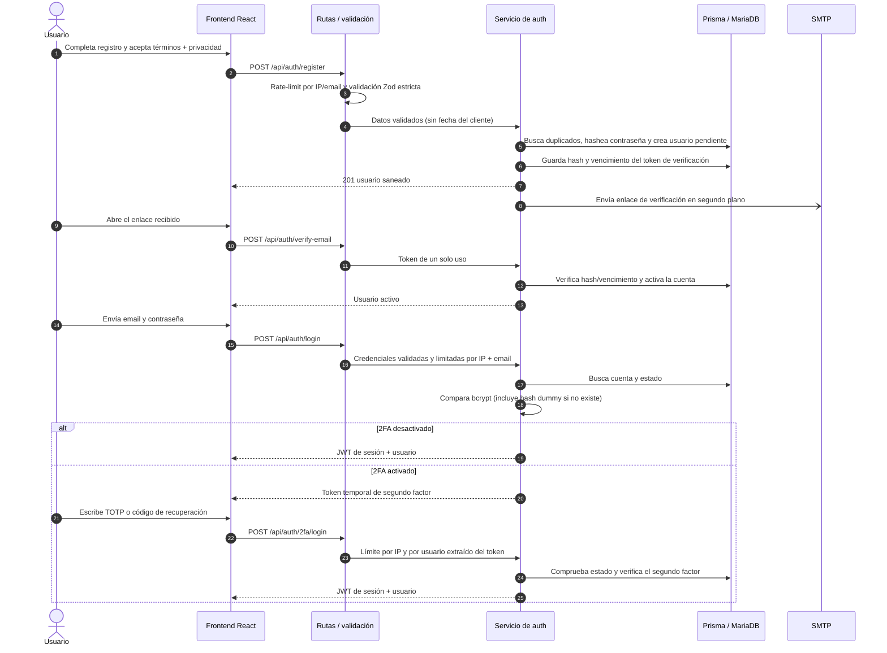

# Autenticación — backend

Este módulo expone la API de identidad de la plataforma: registro, verificación
de correo, inicio y cierre de sesión, gestión de contraseña y segundo factor
(2FA). Las rutas se montan como `/api/auth` desde el registro global de módulos.

- [Documentación del frontend de autenticación](../../../../frontend/src/modules/auth/README.md)
- [Configuración de despliegue del monorepo](../../../../README.md#despliegue)

## Estructura del módulo

| Archivo | Responsabilidad |
| --- | --- |
| `auth.routes.js` | Endpoints, orden de middlewares y documentación OpenAPI |
| `auth.schema.js` | Validación de cuerpos y consultas con Zod |
| `auth.controller.js` | Adaptación HTTP: llama al servicio y construye respuestas |
| `auth.service.js` | Reglas de negocio, persistencia, tokens y contraseña |
| `auth.mail.js` | Contenido y enlaces de los correos |
| `auth.locations.js` | Búsqueda de países y ciudades |
| `@web-platform/shared/alias-policy.js` | Política compartida de alias |
| `@web-platform/shared/location-catalog.js` | Catálogo y normalización de ubicaciones |

Las rutas siguen el patrón `route → middleware → controller → service → Prisma`.
La entrada se valida antes de llegar al servicio y los errores se traducen en
respuestas JSON mediante el middleware global.

## Ciclo principal



### Estado y sesión

1. El registro crea la cuenta con `estado: "pendiente_verificacion"` y
   `emailVerificado: false`. Las credenciales duplicadas se comprueban antes
   de crearla y las carreras de unicidad de Prisma (`P2002`) se responden con
   `409 CONFLICT`.
2. La verificación busca el hash SHA-256 del token, comprueba su vencimiento
   (24 horas) y marca la cuenta como `activo`.
3. El login requiere contraseña válida, email verificado y estado `activo`.
   Si el usuario no existe, también se ejecuta `bcrypt.compare` con un hash
   dummy para reducir la diferencia de tiempo observable.
4. El JWT de sesión contiene `sub`, rol (`tipo`) y versión de sesión (`v`).
   `authenticate` valida firma, versión y que la cuenta siga activa en la BD.
5. Cambiar o restablecer la contraseña incrementa `tokenVersion`; cerrar todas
   las sesiones también la incrementa. Los JWT con una versión anterior se
   rechazan.

## Endpoints

Todos los endpoints están bajo `/api/auth`. La especificación OpenAPI está
disponible en `/api/docs`.

| Método y ruta | Autenticación | Función |
| --- | --- | --- |
| `GET /locations/countries` | No | Catálogo de países |
| `GET /locations/cities?country=ES&q=madrid` | No | Hasta 25 coincidencias; país ISO de 2 letras |
| `POST /register` | No | Crear cuenta; requiere alias, email, contraseña y consentimientos |
| `POST /login` | No | Iniciar sesión o comenzar el flujo 2FA |
| `GET /me` | Bearer JWT | Consultar perfil sin datos sensibles |
| `POST /verify-email` | No | Verificar el token recibido por correo |
| `POST /resend-verification` | No | Reenviar verificación; respuesta genérica |
| `POST /forgot-password` | No | Solicitar restablecimiento; respuesta genérica |
| `POST /reset-password` | No | Cambiar contraseña con token de recuperación |
| `POST /change-password` | Bearer JWT | Cambiar contraseña autenticado; devuelve JWT nuevo |
| `POST /logout-all` | Bearer JWT | Revocar las sesiones incrementando la versión |
| `POST /2fa/setup` | Bearer JWT | Crear secreto TOTP y QR para configurar una app |
| `POST /2fa/enable` | Bearer JWT | Confirmar TOTP, activar 2FA y crear códigos de recuperación |
| `POST /2fa/login` | Token temporal 2FA | Completar login con TOTP o código de recuperación |
| `POST /2fa/disable` | Bearer JWT | Desactivar 2FA tras reautenticar con contraseña y código |
| `POST /2fa/recovery-codes` | Bearer JWT | Regenerar códigos tras reautenticación; invalida los anteriores |

Las entradas se validan en `auth.schema.js`. Por ejemplo, el cuerpo de registro
acepta:

```json
{
  "alias": "ana",
  "email": "ana@example.com",
  "password": "una-clave-segura",
  "consentimientos": {
    "terminos": true,
    "privacidad": true,
    "comunicaciones": false
  }
}
```

El objeto de consentimientos es estricto: no acepta campos adicionales. El
servidor genera `fecha` y agrega `versionPolitica` usando
`CONSENT_POLICY_VERSION`; el cliente no puede enviar ni sustituir esos valores.
`comunicaciones` es opcional y, si falta, se guarda como `false`. La versión
debe identificar la revisión efectivamente publicada de términos y privacidad.

Ejemplo de uso autenticado:

```http
GET /api/auth/me
Authorization: Bearer <jwt-de-sesion>
```

Respuesta de login sin 2FA:

```json
{
  "token": "<jwt-de-sesion>",
  "user": {
    "id": "cuid",
    "alias": "ana",
    "email": "ana@example.com",
    "estado": "activo",
    "twoFactorOn": false
  }
}
```

Con 2FA, `/login` devuelve `twoFactorRequired: true` y `twoFactorToken`; ese
token **solo** sirve para `/2fa/login`, no autoriza rutas privadas. El token de
sesión se entrega después de validar el segundo factor.

## Seguridad y límites

- **Contraseñas:** bcrypt con 10 rondas; nunca se devuelve `passwordHash`.
- **Alias:** la lista de términos prohibidos es un filtro heurístico y débil;
  puede bloquear coincidencias dentro de palabras normales y no sustituye una
  política de moderación.
- **Tokens de correo:** se guarda su hash, no el token original. Verificación:
  24 horas; restablecimiento: 1 hora. Los tokens de reset son de un solo uso.
- **TOTP:** el secreto almacenado se cifra con AES-256-GCM. La clave hexadecimal
  de 64 caracteres (`TOTP_ENCRYPTION_KEY`) se valida al arrancar; no debe
  perderse ni rotarse sin un plan de migración de secretos. Fallos de descifrado
  se escriben en el log de nivel error.
- **2FA:** TOTP acepta una ventana de un intervalo a cada lado, pero cada
  intervalo solo se consume una vez. El contador aceptado se guarda en la cuenta
  con una actualización atómica; el token intermedio contiene `tokenVersion` y
  queda invalidado tras cerrar todas las sesiones o cambiar la contraseña. Los
  códigos de recuperación se muestran al generarlos, solo se almacenan como
  hashes y cada código se consume una vez.
- **Consentimiento:** las aceptaciones obligatorias, la fecha del servidor y
  la versión de política quedan en el JSON `consentimientos` de la cuenta.
- **Errores HTTP:** JSON mal formado responde `400`, payload demasiado grande
  conserva `413`, errores 4xx expuestos mantienen su estado, colisiones
  de unicidad responden `409`; los errores inesperados se registran y responden
  `500` genérico.
- **Cabeceras:** `helmet()` configura cabeceras de seguridad y Express no expone
  `X-Powered-By`.
- **Swagger:** `/api/docs` y `/api/docs.json` no se montan en producción.
- **SMTP:** los mensajes se disparan sin esperar a que el proveedor responda.
  Los fallos quedan registrados, con timeouts de conexión/socket/saludo de
  10 segundos y `requireTLS` en producción. El envío en segundo plano no usa
  una cola durable; un reinicio puede interrumpir un correo pendiente.

### Rate limiting

Los límites siguientes usan el store en memoria predeterminado de
`express-rate-limit` y se omiten en `NODE_ENV=test`, salvo que se active
`RATE_LIMIT_IN_TEST=true`.

| Operación | Límite |
| --- | --- |
| Registro | 5 por hora por IP y 5 por hora por email |
| Login | 10 por 15 minutos por IP+email y 10 por 15 minutos por email; los éxitos no consumen el límite |
| Verificación / recuperación de contraseña | 5 por hora por IP y por email |
| Login 2FA | 20 por 15 minutos por IP y 5 por 15 minutos por usuario, aunque solicite tokens 2FA nuevos |
| Administración 2FA | 5 por 15 minutos por usuario |
| Restablecimiento de contraseña | 10 por 15 minutos por IP; los éxitos no consumen el límite |
| Cambio de contraseña | 5 por 15 minutos por usuario |
| Catálogo de ubicaciones | 60 por minuto por IP |

El store en memoria se reinicia al desplegar y no se comparte entre instancias.
Antes de ejecutar varias instancias se debe configurar un store distribuido.
En producción, `TRUST_PROXY` debe describir correctamente los proxies del
hosting; de lo contrario, la IP usada para estos límites puede ser incorrecta.

## Configuración y despliegue

`env.js` es la única puerta de entrada a `process.env`. En producción (también
si `NODE_ENV` está ausente) se exigen `JWT_SECRET`, `TOTP_ENCRYPTION_KEY`,
`CORS_ORIGIN`, `FRONTEND_URL`, `SMTP_HOST`, `TRUST_PROXY` y
`CONSENT_POLICY_VERSION`. `JWT_SECRET` debe tener al menos 32 caracteres y no
ser un placeholder; `TRUST_PROXY` debe ser un entero positivo. Solo
`development` y `test` permiten valores predeterminados locales.

Los workspaces `backend`, `frontend` y `shared` requieren instalar dependencias
desde la raíz del monorepo. El código común se importa mediante
`@web-platform/shared/*`; `country-state-city` se declara en ese workspace. El
script `postinstall` genera Prisma y
`npm run db:deploy -w backend` aplica las migraciones versionadas de
`backend/prisma/schema/migrations`. No se debe configurar `backend` como raíz
del repositorio en un proveedor que excluya el resto del monorepo: el módulo
usa el workspace `shared`. En Vercel, conserva activado **Include source files
outside Root Directory** si `frontend` es el Root Directory. Para Render usa
la raíz del monorepo y el build `npm ci && npm run db:deploy`, con start
`npm start`.

Las migraciones `20260924084100_init` y `20260927010019_init` tienen el mismo
nombre descriptivo, pero crean tablas distintas (`ecogestos_products` y
`users`); la migración más reciente endurece el almacenamiento de TOTP y permite
que `pais` quede sin seleccionar, en vez de asignar España implícitamente.

## Pruebas

Desde la raíz:

```bash
npm test --workspace backend
```

Las pruebas usan Prisma y SMTP simulados en la mayoría de los casos; verifican
el comportamiento de la API y del servicio sin conectarse a MariaDB. El backend
local sí usa la instancia MariaDB que tengas en Docker; revisa la [guía de
arranque local](../../../../README.md#mariadb-local-en-docker) para configurar
`DATABASE_URL`.

| Área | Qué comprueban los tests | Comportamiento que se rechaza |
| --- | --- | --- |
| Registro y validación | Campos, consentimientos estrictos, email normalizado, límites de contraseña y conflictos de unicidad | Crear cuentas con datos inválidos o consentimiento incompleto; responder 500 ante email/alias duplicado o carrera `P2002` |
| Inyección en entradas | Un email con texto similar a una inyección SQL, como `' OR '1'='1`, no pasa el esquema | Tratar datos del usuario como una consulta SQL ejecutable |
| Login y sesión | Contraseña incorrecta o cuenta inactiva, firma/expiración JWT y versión de sesión | Autenticar sin credenciales válidas, aceptar cuenta suspendida o devolver hashes/secretos |
| Correo y tokens | Verificación/reset con token válido, desconocido, vencido o ya usado; respuesta no enumerativa | Reutilizar tokens o revelar si un email existe mediante el resultado HTTP |
| 2FA | Token temporal firmado y vigente, tokenVersion, TOTP no reutilizable y códigos de recuperación de un solo uso | Saltarse el segundo factor, reusar un TOTP/código o usar un token temporal como JWT de sesión |
| Limitación de intentos | Límites por IP/email/usuario y fallback por IP ante token 2FA sin firma válida | Reiniciar intentos cambiando de IP/token o bloquear arbitrariamente a otra cuenta con un JWT forjado |
| Endpoints protegidos | Autorización Bearer, estado activo y revocación de sesión | Acceder sin token válido, con rol/estado no permitido o con sesión revocada |

El servicio de autenticación usa consultas estructuradas de Prisma y no
construye SQL concatenando entradas. El test de email con forma de inyección
comprueba el rechazo por validación; **no** es una prueba de penetración ni
demuestra por sí solo que cualquier campo o consulta esté libre de inyección.
Las pruebas con Prisma simulado tampoco sustituyen una prueba de integración
contra una base desechable.

Para ejercitar los límites:

```bash
RATE_LIMIT_IN_TEST=true npm test --workspace backend -- auth.ratelimit
```

Para validar migraciones, arranca la MariaDB Docker local y configura una base
de datos de pruebas vacía en `DATABASE_URL`; no uses una base con datos reales.
