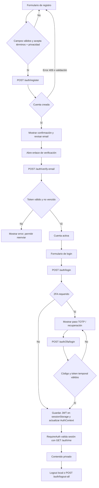

# Autenticación — frontend

El módulo implementa las pantallas y el estado de sesión para registro, login,
verificación por correo, restablecimiento de contraseña y seguridad de cuenta.
Consume la API `/api/auth` del backend.

- [Documentación del backend de autenticación](../../../../backend/src/modules/auth/README.md)
- [Configuración general y despliegue](../../../../README.md#despliegue)

## Organización

| Archivo / carpeta | Responsabilidad |
| --- | --- |
| `AuthContext.jsx` | Estado global de sesión y acciones `login`, `logout`, `applySession` |
| `api.js` | Funciones cliente para endpoints de autenticación |
| `tokenStorage.js` | Guarda el JWT en `sessionStorage` |
| `errors.js` | Convierte códigos de error de API en mensajes y tiempos de espera |
| `validation.js` | Validaciones pequeñas compartidas por formularios |
| `guards.jsx` | Protege rutas autenticadas y restringidas por rol |
| `pages/` | Pantallas de registro, login, verificación, reset y seguridad |
| `components/` | Formularios y UI de 2FA, códigos de recuperación y contraseña |

Las peticiones pasan por `@/shared/api/client.js`: serializa JSON, agrega el
JWT si hay sesión y convierte errores HTTP a `ApiError`. La URL base se
configura con `VITE_API_URL`; en desarrollo puede quedar vacía si Vite usa el
proxy local.

## Ciclo de usuario



### Registro y verificación

`RegisterPage` consulta países y ciudades al backend y valida en el navegador
alias, email, contraseña de al menos 8 caracteres y un máximo de 72 bytes
UTF-8, además de los campos requeridos. El formulario
envía un objeto de consentimiento como:

```js
consentimientos: {
  terminos: true,
  privacidad: true,
  comunicaciones: form.comunicaciones,
}
```

No envía fecha: el backend registra la hora y `CONSENT_POLICY_VERSION`.
El usuario debe aceptar términos y privacidad; comunicaciones es opcional. Al
crear la cuenta, la UI indica revisar el correo y ofrece la pantalla de reenvío.
El estado pendiente no permite iniciar sesión hasta completar la verificación.
El filtro de alias se basa en una lista heurística; puede tener falsos positivos
y no es un sistema completo de moderación.

### Login y estado de sesión

1. `LoginPage` valida email y contraseña y llama a `useAuth().login`.
2. Si el backend devuelve una sesión directa, `AuthContext.applySession` guarda
   el JWT en `sessionStorage`, configura el cliente API y marca el estado como
   autenticado.
3. Si el backend responde `twoFactorRequired`, la pantalla no guarda ese token
   temporal como sesión. `TwoFactorStep` envía el TOTP o código de recuperación
   a `POST /auth/2fa/login`.
4. Solo el JWT final se guarda como sesión. Si se usó un código de
   recuperación, puede mostrarse el aviso de códigos restantes.
5. Al cargar la aplicación, `AuthProvider` recupera el JWT y solicita
   `GET /auth/me`. Un token expirado, revocado o inválido, o una cuenta con
   `ACCOUNT_INACTIVE`, limpia la sesión y redirige al login. Un problema de red
   muestra estado de error y opción de reintentar.
6. `RequireAuth` protege rutas privadas; `RequireRole` verifica
   `tipoUsuario` del usuario cargado.

`sessionStorage` limita la persistencia a la pestaña/sesión del navegador; no
es almacenamiento compartido entre pestañas ni una cookie HttpOnly. El
frontend no debe escribir, imprimir en logs ni incluir el JWT en URLs.

## Pantallas y capacidades

| Pantalla | Función |
| --- | --- |
| `pages/RegisterPage.jsx` | Registro, ubicaciones, consentimiento y confirmación de correo |
| `pages/LoginPage.jsx` | Login, continuación 2FA y enlaces de recuperación |
| `components/TwoFactorStep.jsx` | TOTP, código de recuperación y token 2FA vencido |
| `pages/VerifyEmailPage.jsx` | Verificación a partir del `token` de la URL |
| `pages/ResendVerificationPage.jsx` | Solicitar reenvío con respuesta no enumerativa |
| `pages/ForgotPasswordPage.jsx` | Solicitar recuperación sin revelar si existe el email |
| `pages/ResetPasswordPage.jsx` | Cambiar contraseña con el token del enlace |
| `pages/SecurityPage.jsx` | Cambio de contraseña, 2FA y cierre de sesiones |
| `components/TwoFactorSection.jsx` | Configurar, activar, desactivar 2FA y gestionar recuperación |
| `components/RecoveryCodes.jsx` | Mostrar los códigos de recuperación recién generados |
| `components/ChangePasswordForm.jsx` | Cambiar contraseña con la sesión actual |
| `components/LogoutAllSection.jsx` | Revocar sesiones del usuario |

## Contrato de API consumido

Todas las funciones cliente están en `api.js`; reciben o devuelven JSON. Las
rutas protegidas agregan automáticamente `Authorization: Bearer <token>` en
el cliente común.

| Función de `api.js` | Endpoint |
| --- | --- |
| `listRegistrationCountries()` | `GET /auth/locations/countries` |
| `searchRegistrationCities({ country, query })` | `GET /auth/locations/cities` |
| `register(data)` | `POST /auth/register` |
| `login(credentials)` | `POST /auth/login` |
| `loginTwoFactor({ twoFactorToken, code })` | `POST /auth/2fa/login` |
| `me()` | `GET /auth/me` |
| `verifyEmail(token)` | `POST /auth/verify-email` |
| `resendVerification(email)` | `POST /auth/resend-verification` |
| `forgotPassword(email)` | `POST /auth/forgot-password` |
| `resetPassword({ token, password })` | `POST /auth/reset-password` |
| `changePassword({ currentPassword, newPassword })` | `POST /auth/change-password` |
| `logoutAll()` | `POST /auth/logout-all` |
| `twoFactorSetup()` / `twoFactorEnable(code)` | `POST /auth/2fa/setup` y `/auth/2fa/enable` |
| `twoFactorDisable({ password, code })` | `POST /auth/2fa/disable` |
| `regenerateRecoveryCodes({ password, code })` | `POST /auth/2fa/recovery-codes` |

Los límites del backend también pueden responder `429`. El cliente lee
`Retry-After`, y `errors.js` presenta el tiempo de espera al usuario. Los
errores relevantes incluyen `INVALID_CREDENTIALS`, `EMAIL_NOT_VERIFIED`,
`USER_ALREADY_EXISTS`, `INVALID_TWO_FACTOR_CODE`, `INVALID_TWO_FACTOR_TOKEN`,
`ACCOUNT_INACTIVE`, `TOKEN_EXPIRED` y `SESSION_REVOKED`.

## Segundo factor y seguridad de cuenta

La sección de seguridad solicita autenticación antes de desactivar 2FA o
regenerar códigos: contraseña actual y TOTP/código de recuperación. Al activar
2FA, el backend devuelve una sola vez diez códigos de recuperación; la UI debe
presentarlos como secretos y explicar que se guardan en forma de hash y cada
uno solo se acepta una vez.

Al cambiar la contraseña, el backend invalida sesiones previas y devuelve un
JWT nuevo para la sesión actual. `logout-all` incrementa la versión de sesión
del usuario; esto también invalida un paso 2FA pendiente. Cada intervalo TOTP
solo se puede usar una vez. Después de cerrar todas las sesiones, el frontend
debe borrar el token y regresar al login.

## Desarrollo y pruebas

Desde la raíz del monorepo:

```bash
npm test --workspace frontend
npm run build --workspace frontend
```

Las pruebas del frontend simulan las llamadas a la API: no requieren Docker ni
MariaDB. Para desarrollar el flujo completo, el frontend llama al backend, y
es el backend quien se conecta a MariaDB local en Docker mediante `DATABASE_URL`.
Consulta la [guía de arranque local](../../../../README.md#mariadb-local-en-docker).

| Área | Qué comprueban los tests | Comportamiento que se rechaza |
| --- | --- | --- |
| Registro | Validación de alias, contraseña, país/ciudad y consentimientos; estados de carga y resultado | Enviar alias prohibido, contraseña de más de 72 bytes o ciudad escrita que no se eligió de las sugerencias |
| Login y 2FA | TOTP/código de recuperación, token temporal vencido, sesión y navegación | Abrir sesión antes del segundo factor, guardar el token temporal como sesión o continuar con código incorrecto |
| Sesión | Restauración, expiración/revocación, cuenta inactiva y error de red | Mantener una sesión inválida o tratar un fallo de red como una sesión cerrada |
| Contraseñas y correo | Enlaces inválidos, confirmación de contraseña, límites y mensajes de error | Enviar formularios incompletos, contraseñas que no coinciden o reset sin token válido |
| Acciones protegidas | Guardas por autenticación/rol, confirmación de logout global y errores accesibles | Mostrar contenido privado a un usuario anónimo o con rol incorrecto; borrar la sesión si el cierre remoto falla |

Los tests de interfaz prueban el comportamiento del navegador con respuestas
simuladas; **no** comprueban autorización real, consultas SQL ni protección
contra inyección SQL. Esas validaciones pertenecen al backend y a pruebas
integradas con la API. El frontend nunca debe considerarse una barrera de
seguridad para datos que recibe el servidor.
